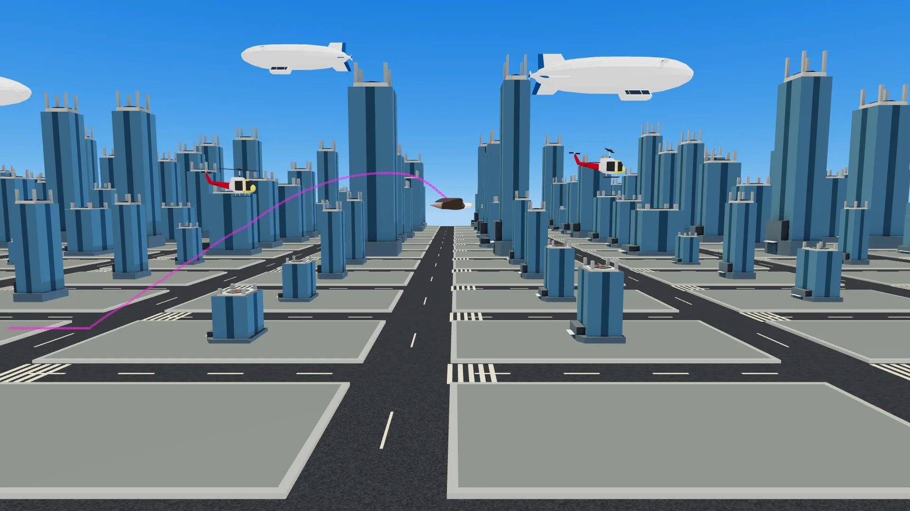
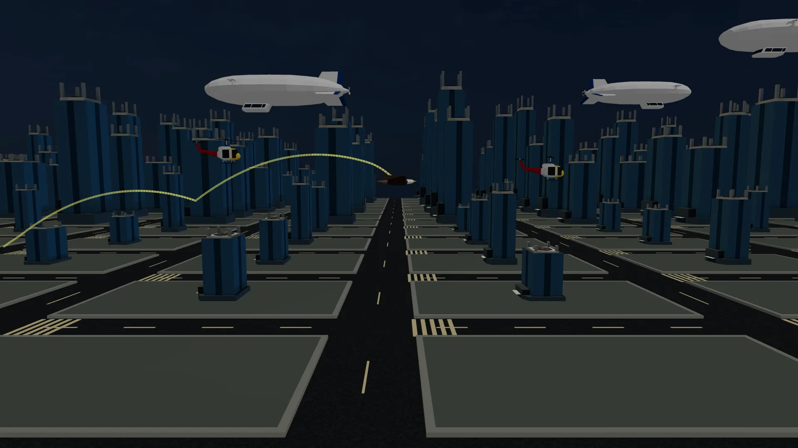
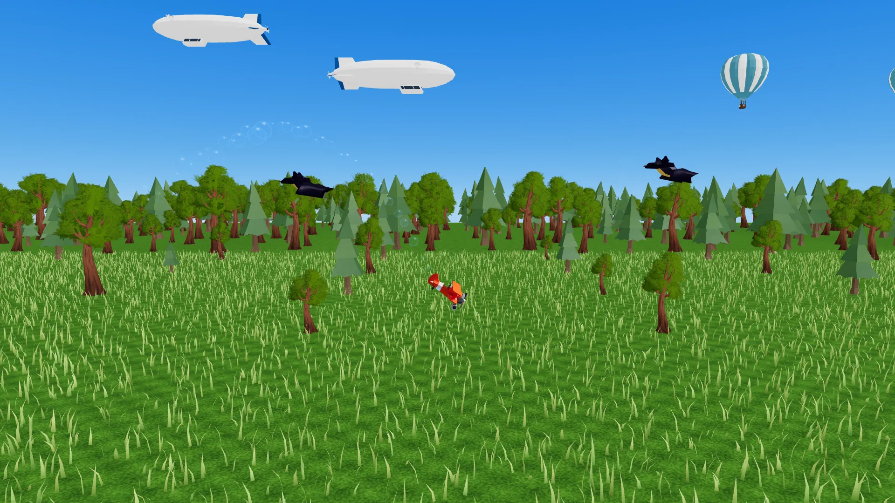
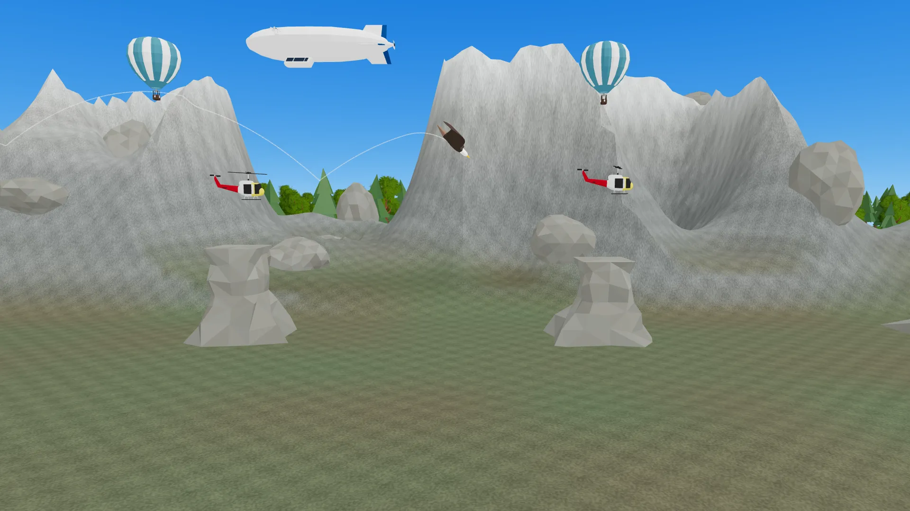
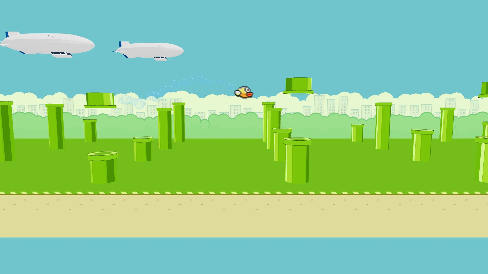
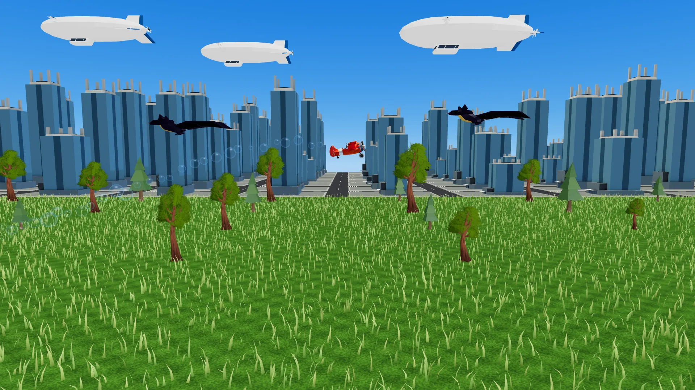

# Eager Eagle

Get the furthest you can while avoiding the obstacles. Unlock new customizations and abilities by unlocking distance milestones.



## Getting Started

First you will need to setup a .env file from the .env.sample provided.

Then development server can be run:

```bash
pnpm run dev
```

## Scripts

In the scripts folder is reset_public and sync_to_s3. This is only for Articles Media usage. Allows for putting public folder to CloudFront to lower Vercel charges for the public facing site.

## TODO

- More scenic darkMode lighting
- Customizable Hot Air Ballon and Airship. Maybe just call this Upper Sky Object in Customize Modal.
- Show upcoming unlocks in game over modal
- Fix online scoreboard and add toggle for offline/online display
- Daily seed based positioning approach with optional manual override so all users experience the same course and can learn to practice tough sections.

## Multiplayer

No multiplayer in this game but there is a offline and online scoreboard. Users can place and compete on the online scoreboard if logged into Articles Media!

## Scripts

In the scripts folder is reset_public and sync_to_s3. This is only for Articles Media usage. Allows for putting public folder to CloudFront to lower Vercel charges for the public facing site.

## Inspiration

[Flappy Bird](https://en.wikipedia.org/wiki/Flappy_Bird)  
[Jetpack Joyride](https://en.wikipedia.org/wiki/Jetpack_Joyride)

## Previews



City in dark mode



Forest scene



Mountain scene



Pipes scene



Example of mixing and matching the different customizations (Tree ground object mixed with City background)

## Attributions

[Eagle Icon - maxicons](https://www.flaticon.com/authors/maxicons)  
[Eagle Model - Google](https://poly.pizza/m/1Z5L1v0bfu7)  
[Airplane Model - Google](https://poly.pizza/m/8VysVKMXN2J)  
[Building One Model - Google](https://poly.pizza/m/fuAgJluDLwx)  
[Helicopter Model - Google](https://poly.pizza/m/cTzINMr0WdS)  
[Bat Model - Quaternius](https://poly.pizza/m/hNO9XvjlKa)  
[Mountain Model - Quaternius](https://poly.pizza/m/a52gSEEq8X)  
[UFO Model - Google](https://poly.pizza/m/b0N_HeT_Ttb)  
[Hot Air Ballon Model - Google](https://poly.pizza/m/7Fej0Jd3_Di)  
[Airship Model - Google](https://poly.pizza/m/dRpj4_t2keh)  
[Tree - Quaternius](https://poly.pizza/m/qZtx0AHhcy)  
[Simple Tree - pmndrs](https://github.com/pmndrs/examples/tree/main/examples/pairing-threejs-to-ui/src/assets)

[Game Music - CodeManu](https://opengameart.org/content/platformer-game-music-pack)  
[Hit Noise](https://freesound.org/people/JmanGord/sounds/784625/)  
[Fly Noise](https://freesound.org/people/felipe.j/sounds/427629/)  
[Dive Noise](https://opengameart.org/content/wind-whoosh-loop)
